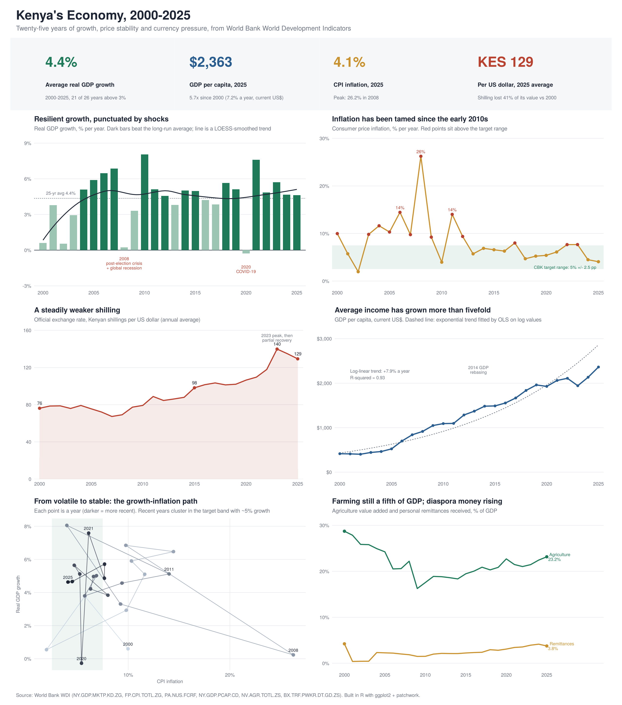

# Kenya's Economy, 2000–2025: a ggplot2 Dashboard

A six-panel statistical dashboard built in R with **ggplot2 + patchwork**, using **real World Bank World Development Indicators** data for Kenya.



## The story in the data

- **Growth has been resilient.** Real GDP grew 4.4% a year on average; 21 of 26 years beat 3%. The two contractions/near-stalls line up with the 2008 post-election crisis plus global recession, and COVID-19 in 2020.
- **Inflation was tamed.** The standard deviation of annual inflation fell from **5.9 points (2000–2012) to 1.3 points (2013–2025)**, and recent years sit inside the Central Bank of Kenya's 2.5–7.5% target range.
- **The shilling weakened steadily**, from KES 76 to a 2023 peak of KES 140 per dollar, before a partial recovery to 129 in 2025.
- **Average income grew 5.7x in dollar terms** (US$415 to US$2,363). A log-linear OLS fit gives about 7.9% a year (R² = 0.93).
- **Structure is shifting slowly:** agriculture is still about a fifth of GDP, while diaspora remittances have risen to around 4% of GDP.

## Techniques shown

| Technique | Panel |
|---|---|
| Conditional fill against a computed benchmark + LOESS smoothing | GDP growth |
| Reference band (policy target) with rule-based point highlighting and auto-labelled extremes | Inflation |
| Log-linear regression fitted in R and overlaid as a trend | GDP per capita |
| Connected scatter with a colour-encoded time path and arrows | Growth vs inflation |
| Tidy reshaping (`pivot_longer`) and direct end-labels instead of a legend | Structure |
| KPI tiles computed from the data, custom theme, `patchwork` multi-panel layout | Whole dashboard |

The script also prints summary statistics, the growth-inflation correlation with a significance test (r = −0.20, p = .33, so no reliable trade-off), and the trend-fit statistics.

## Data

[`data/kenya_wdi_2000_2025.csv`](data/kenya_wdi_2000_2025.csv), downloaded from the World Bank API in October 2026. Indicators: `NY.GDP.MKTP.KD.ZG`, `FP.CPI.TOTL.ZG`, `PA.NUS.FCRF`, `NY.GDP.PCAP.CD`, `NV.AGR.TOTL.ZS`, `BX.TRF.PWKR.DT.GD.ZS`. Set `REFRESH <- TRUE` in the script to re-download with the `WDI` package.

## Run it

```r
install.packages(c("ggplot2", "dplyr", "tidyr", "scales", "patchwork"))  # + "WDI" to refresh
source("kenya_dashboard.R")   # writes output/kenya_economy_dashboard.png and .pdf
```
