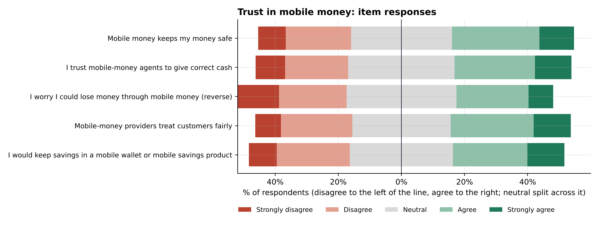
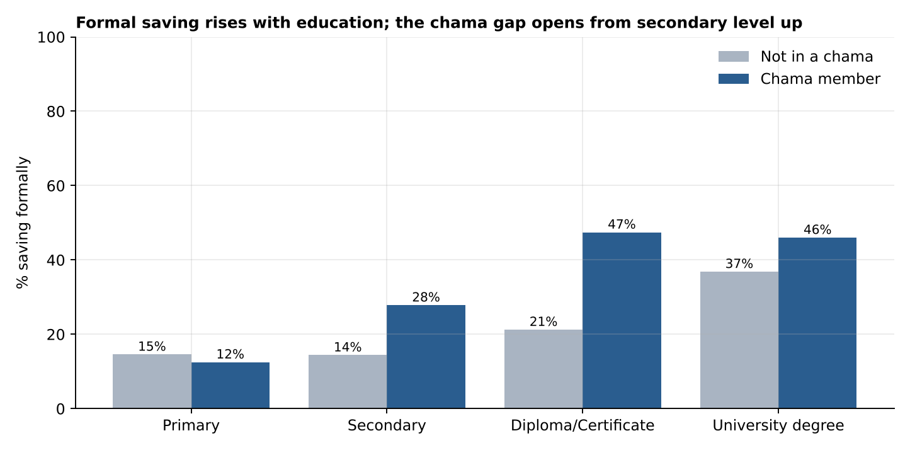
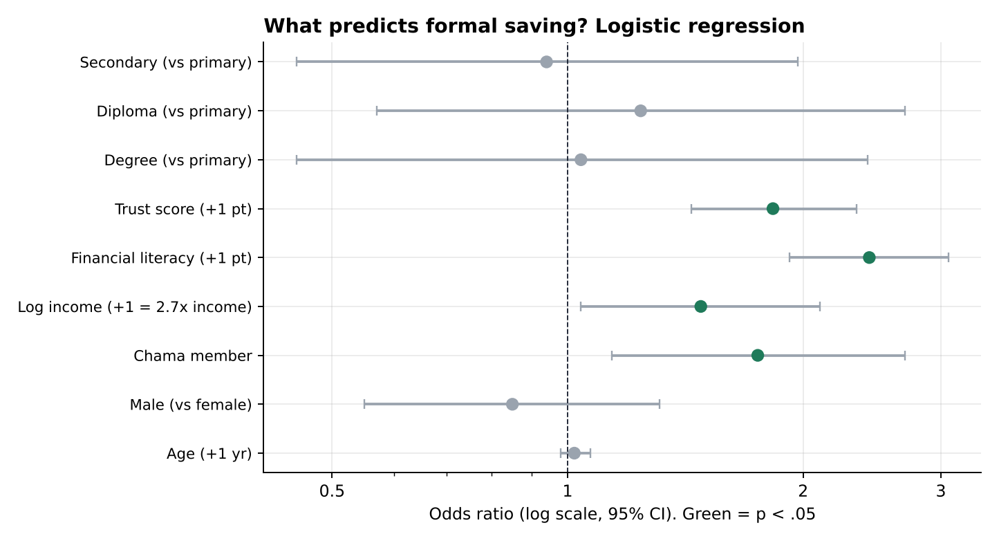

# Case Study: Why Young Kenyans Do or Don't Save Formally

**Survey analysis of mobile-money trust, financial literacy and saving behaviour among 600 adults aged 18–35 in Embu, Nairobi and Kisumu**

*Tools: IBM SPSS Statistics (syntax-driven), replicated in Python (statsmodels, SciPy) · Author: Berechiah Kibet · 2026*

> **Data note.** The dataset is simulated to mirror the structure of a real KoboToolbox survey export (labelled variables, Likert scales, a reverse-worded item, item non-response). Findings illustrate the analytical workflow and should not be cited as evidence about Kenya.

---

## 1. The business question

A SACCO planning a youth savings product wanted to know three things before spending on marketing:

1. **Who already saves formally** (bank, SACCO or mobile savings product), and who doesn't?
2. **Is the barrier trust or knowledge?** Should the campaign reassure people about safety, or teach budgeting and product comparison?
3. **Do chamas (informal savings groups) compete with formal saving or feed into it?**

## 2. Method

| Item | Detail |
|---|---|
| Design | Cross-sectional household survey, face-to-face with tablet (CAPI) |
| Sample | n = 600 adults aged 18–35; Nairobi 42.3%, Embu 33.2%, Kisumu 24.5% |
| Instrument | 20 variables: demographics, income, 5-item **Trust in Mobile Money** scale, 4-item **Financial Literacy** scale (both 5-point Likert), mobile-money use frequency, chama membership, formal saving, amount saved |
| Missing data | Item non-response ≤ 2.5% per variable; scale scores computed when ≥ 80% of items answered (`MEAN.4`, `MEAN.3`); listwise deletion in regressions (n = 583) |
| Analysis | Reliability (Cronbach's α), exploratory factor analysis, χ², independent t-tests, one-way ANOVA with Tukey HSD, Kruskal-Wallis, binary logistic regression, multiple linear regression with diagnostics |
| Significance | α = .05, two-tailed; effect sizes reported for every test |

All steps are in [`spss/analysis.sps`](spss/analysis.sps) and replicated line by line in [`src/02_replicate_analysis.py`](src/02_replicate_analysis.py).

## 3. Sample profile

Respondents averaged **26.5 years** (SD 5.3); 46.3% were women. Secondary school was the most common education level (41.2%), followed by diploma/certificate (26.3%), degree (17.8%) and primary (14.7%). Almost a quarter (24.8%) were unemployed and only 13.8% held salaried jobs. Median monthly income was **KES 16,500** and median savings last month **KES 1,505**.

**47.2% belonged to a chama, but only 26.8% saved formally.** That gap is the opportunity.

## 4. Are the scales trustworthy?

| Scale | Items | Cronbach's α | Interpretation |
|---|---|---|---|
| Trust in mobile money | 5 | **.908** | Excellent |
| Financial literacy | 4 | **.903** | Excellent |

**Catching a data-quality trap.** Item `trust3` ("I worry I could lose money through mobile money") is negatively worded. Left un-reversed, the trust scale's α collapses to **.44**, which would have made the scale unusable and silently weakened every downstream model. Reverse-coding it (`RECODE trust3 (1=5)(2=4)…`) restored reliability. Factor analysis confirmed two distinct factors matching the two scales: two eigenvalues above 1 (3.68 and 3.07, the next 0.39), with every item loading ≥ .77 on its own factor.

## 5. Hypothesis tests

| # | Question | Test | Result | Effect size | Verdict |
|---|---|---|---|---|---|
| H1 | Are women more likely to join chamas? | χ² | χ²(1, N = 600) = 34.62, p < .001 | φ = .24 (small–medium) | **Yes**: 60.1% of women vs 36.0% of men |
| H2 | Are women more likely to save formally? | χ² | χ²(1, N = 600) = 1.00, p = .318 | φ = .04 | **No difference**: 28.8% vs 25.2% |
| H3a | Do formal savers trust mobile money more? | Independent t-test | t(598) = 6.35, p < .001 | Cohen's d = 0.59 (medium) | **Yes**: 3.50 vs 2.95 |
| H3b | Do formal savers have higher financial literacy? | Independent t-test | t(598) = 9.27, p < .001 | Cohen's d = 0.85 (large) | **Yes**: 3.61 vs 2.78 |
| H4 | Does financial literacy differ by education? | One-way ANOVA | F(3, 596) = 24.62, p < .001 | η² = .11 (medium) | **Yes**: rises from 2.45 (primary) to 3.52 (degree) |
| H5 | Does mobile-money use differ by county? | Kruskal-Wallis | H(2) = 18.06, p < .001 | – | **Yes**: Nairobi median "several times a week" vs "weekly" elsewhere |

Levene's tests were non-significant for H3 and H4 (p > .07), so equal-variance results are reported. Tukey post-hoc tests for H4 showed every education pair differs except diploma vs degree (p = .061).

**Reading across H3a and H3b:** both gaps are real, but the literacy gap (d = 0.85) is noticeably larger than the trust gap (d = 0.59). The regression below tests whether that holds once everything is controlled.

## 6. Who saves formally? Binary logistic regression

Outcome: saves with a bank, SACCO or mobile savings product (1 = yes). n = 583.

| Predictor | Odds ratio | 95% CI | p |
|---|---|---|---|
| Financial literacy (+1 point) | **2.43** | 1.92 – 3.07 | < .001 |
| Trust in mobile money (+1 point) | **1.83** | 1.44 – 2.34 | < .001 |
| Chama member | **1.75** | 1.14 – 2.70 | .011 |
| Log monthly income | **1.48** | 1.04 – 2.10 | .029 |
| Male (vs female) | 0.85 | 0.55 – 1.31 | .468 |
| Age (+1 year) | 1.02 | 0.98 – 1.07 | .252 |
| Secondary / Diploma / Degree (vs primary) | 0.94 / 1.24 / 1.04 | all CIs span 1 | > .58 |

**Model fit:** χ²(9) = 131.78, p < .001; Nagelkerke R² = .294; Hosmer-Lemeshow χ²(8) = 5.30, p = .725 (good calibration); classification accuracy 79.2% against a 73.2% baseline.

**The most interesting result is what disappears.** Education strongly predicts formal saving on its own (Figure 2), yet its odds ratios fall to roughly 1 once financial literacy is in the model. Education seems to matter *through* the practical money skills it builds, rather than directly. That suggests a literacy intervention could reach people the school system didn't.

## 7. How much do savers put away? Multiple linear regression

Outcome: log(amount saved last month + 1). n = 583.

| Predictor | B | Std. β | p |
|---|---|---|---|
| Log monthly income | 1.646 | .672 | < .001 |
| Financial literacy | 0.313 | .209 | < .001 |
| Chama member | 0.389 | .125 | < .001 |
| Trust in mobile money | 0.068 | .042 | .139 |
| Age | −0.010 | −.035 | .214 |

R² = .552, adjusted R² = .548, F(5, 577) = 141.92, p < .001. All VIFs ≤ 1.04 (no multicollinearity) and Durbin-Watson = 1.97 (independent residuals). A Breusch-Pagan test **did** flag heteroscedasticity (p < .001), so the model was re-estimated with HC3 robust standard errors: every significance conclusion was unchanged (trust remained non-significant, p = .154).

Each extra point of financial literacy is associated with about **37% more saved** (e^0.313), and chama members save about **48% more** (e^0.389) at the same income. **Trust drives *whether* people open a formal account, but not *how much* they put in.** Literacy drives both.

## 8. Recommendations for the SACCO

1. **Lead with skills, not reassurance.** Literacy has the strongest effect on both joining (OR 2.43) and amount saved. Fund budgeting and product-comparison workshops ahead of safety-messaging adverts.
2. **Use trust messaging only at the sign-up step.** It moves the account-opening decision but not deposit size, so put it on onboarding screens and agent scripts.
3. **Recruit through chamas, not against them.** Chama members are 1.75× more likely to save formally. Offer group accounts or chama-to-SACCO top-up features. Women are 24 points more likely to be in chamas, so this also reaches women efficiently.
4. **Don't target by education level.** Once literacy is measured, education adds nothing. A five-question literacy screener at onboarding is a better targeting tool than a CV field.
5. **Pilot in Nairobi first, then adapt.** Nairobi respondents use mobile money most often, so digital-first features will land fastest there; Embu and Kisumu may need more agent-led onboarding.

## 9. Limitations

- Cross-sectional data show association, not causation. A randomised literacy pilot would be needed to confirm the effect.
- Self-reported income and savings are prone to recall and social-desirability bias.
- The "education works through literacy" reading is suggestive. A formal mediation test (e.g. PROCESS Model 4 with bootstrapped indirect effects) is the natural next step.
- Simulated data: replace with field data before acting on results.

## 10. Skills demonstrated

Questionnaire variable design and labelling · data cleaning and reverse coding · scale reliability and factor analysis · parametric and non-parametric hypothesis testing · effect sizes · binary logistic and multiple linear regression with full diagnostics · reproducible SPSS syntax · cross-validation of results in Python · translating statistics into business recommendations.
