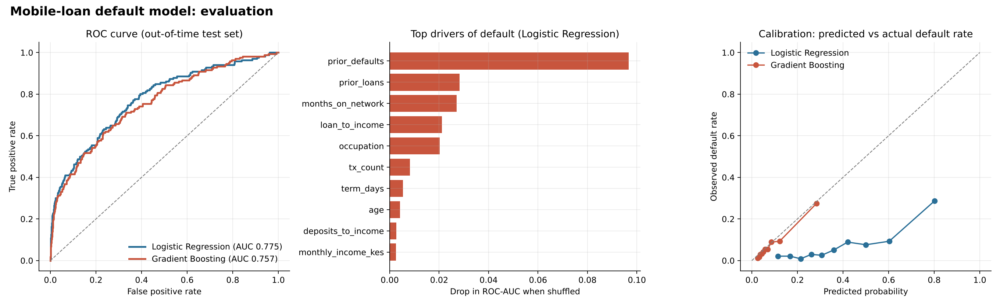

# Predicting Mobile-Loan Default with SQL + Python

**Question:** Can a digital lender spot which mobile loans will default *before* disbursing them, using only data it already holds?

**Answer:** Yes. A model built on SQL-engineered features ranks risk well (ROC-AUC **0.775** on an out-of-time test set). Sending the riskiest 20% of applications to manual review catches **54% of all defaults**, and flagged loans default at **2.7x** the average rate (19% vs 7%).



## What this project shows

| Skill | Where |
|---|---|
| Relational schema design (keys, constraints, indexes) | [`sql/schema.sql`](sql/schema.sql) |
| Business questions answered in SQL: JOINs, `CASE` banding, `GROUP BY`, `RANK()`, moving averages | [`sql/02_exploratory_queries.sql`](sql/02_exploratory_queries.sql) |
| Feature engineering in SQL: CTEs, conditional aggregation, **leakage-safe window functions** | [`sql/03_feature_engineering.sql`](sql/03_feature_engineering.sql) |
| Python ML pipeline: preprocessing, two models, out-of-time validation, permutation importance, calibration | [`src/02_train_model.py`](src/02_train_model.py) |

## Data

A SQLite database of **5,000 customers, 12,528 loans and 106,164 wallet transactions** across ten Kenyan counties. The data is **simulated** by [`src/01_build_database.py`](src/01_build_database.py) (seeded, fully reproducible) because real lending data is confidential; defaults are driven by realistic risk signals with noise.

## Key SQL findings

| Finding | Evidence |
|---|---|
| Overall default rate 8.1% on KES 131.7M disbursed | `portfolio_overview` |
| Casual workers (13.9%) and students (12.9%) default at about 2.5x the rate of salaried borrowers (5.4%) | `default_by_occupation` |
| Default risk more than triples (6.2% to 21.8%) as loan size rises from under 25% to over 100% of monthly income | `default_by_loan_to_income_band` |

All query outputs are saved in [`outputs/sql_results/`](outputs/sql_results/).

## Modelling approach

- **Time-based split:** train on loans issued Jan–Aug 2024, test on Sep–Oct 2024. This mimics real deployment better than a random split.
- **No leakage:** `prior_defaults` uses a window frame ending at `1 PRECEDING`, so a loan never sees its own outcome.
- **Models:** class-weighted logistic regression (best, AUC 0.775) vs. histogram gradient boosting (AUC 0.757). The simpler model won, which is common when the signal is mostly linear, and it is easier to explain to credit committees.
- **Top drivers:** prior defaults, number of prior loans, network tenure, loan-to-income ratio, occupation.

**Note on calibration (right-hand chart):** `class_weight="balanced"` improves ranking but inflates predicted probabilities. That's fine for a review queue based on rank; if the bank needed true default probabilities for pricing or provisioning, the next step would be to recalibrate (e.g. `CalibratedClassifierCV`) or drop the class weights.

## Run it

```bash
pip install pandas numpy scikit-learn matplotlib joblib
python src/01_build_database.py     # builds data/mobile_lending.db
python src/02_train_model.py        # runs SQL, trains and evaluates models
```
